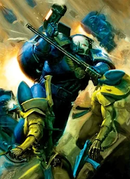

# Veteran Marines

**Steam Workshop ID:** 2175959340

**Source:** [Live Steam Workshop item](https://steamcommunity.com/sharedfiles/filedetails/?id=2175959340)

**Metadata retrieved (UTC):** 2026-11-13T23:02:05+00:00

**Content:** Recovered Steam Workshop install, not reconstructed source.

## Recovered preview files





[Current Steam thumbnail](https://images.steamusercontent.com/ugc/1461932727954767854/5629C73722ED1713BFB63F9C5342516FCCE723CE/)


## Steam Workshop description

Captured unchanged from Steam's GetPublishedFileDetails API. BBCode is retained literally rather than guessed or paraphrased.

```text
[h1]Veteran Marines [/h1]
"Both the highly honored and the lowest of low in the chapter will see battle this day. An updated deployment roster has been released by I the Chaptermasters personal seneschal " 
- Aide-de-camp,Ordinator of the House. 

Buildings to be added to those we are to use on the surface are the relocation of the primary Arming Chambers from those that are abroad our vessel to one built upon the surface, seeing as we are reclaiming this world not merely conquering it. 
They include supplies workshops for the maintenance and repair of armour and weapons as well as limited living space for personnel to be ready at all times for chapter use. 
While not strictly needed for the donning and removal of armor these chambers take much of the taxing nature of this process off of the wearer, And reduce the amount of time it takes to repair and maintain said armour. 
The cant of chapter serfs and tech marines a background hum to an experienced marine, allowing them to focus on preparing for the missions ahead and taking in valuable briefing information and terrain data designed to help them make the most of the combat ahead of them.

Veteran Marines are those Astartes in the Loyalist Space Marine Chapters who have gained considerable experience in the service of their Chapter and often serve in the Chapter's elite 1st Company which is comprised solely of Veteran Squads or as an elite corps or Command Squad within a Chapter's other companies. 
Veteran Squads are exclusively a part of the 1st Company of the Chapter. The Veteran Squad's white tactical symbol is based on the Crux Terminatus used by the Chapter's Terminators. 
These will be deployment ready in Full unit size for greater tactical weight, rather than the detached 5 man squads of tactical marines.

[quote=Sergeant Daegon Incursa, 1st Company, Invaders Chapter]"The deeds of one bold warrior can alter the course of a battle. I have four such men under my command, and our every deed changes the shape of the galaxy."[/quote]

Also added is Loyalist Tech-priest Enginseers in place of a worrying lack of Chapter Techmarines in scattered numbers their services are being kept busy Arming units and keeping the orbiting vessel in working order,A Enginseer, also called a Tech-priest Enginseer, is a tech-priest of the Adeptus Mechanicus whose specialisation is the maintenance and repair of the many technological instruments of the Imperium of Man, both in peace as in war. 
Enginseers are engineer mystics, members of the Adeptus Mechanicus who are dedicated to the Machine God and steeped in arcane knowledge. Enginseers are the most commonly seen members of the Mechanicus, for they are present wherever a somewhat technologically advanced human settlement resides. it is less than Ideal for the Chapter to be honoring these men as battlefeild equals but the lack of TechMarines Leaves us no choice but to leave battlefield repair and construction tasks to such as these.

[quote=Magos Aubrey Bessemer]"The Tech-priest tends his flock of Chimeras and lasguns as surely as his priestly brethren from the Ecclesiarchy tend the souls of their Guardsmen, and his ministrations are no less important to the continued success of the numerous campaigns of the Imperial Guard."[/quote]


and last but not least added to the combat listing is the Chapter Serfs A Chapter serf is a Human bondsman or bondswoman who acts as the indentured servant of a Space Marine Chapter for life. 
The battle-brothers themselves are far too few to fulfill all the tasks required to keep the Chapter running at peak efficiency. 
It is the Chapter serfs who perform most of these sometimes very menial but nevertheless vital functions, freeing up the Space Marines' time and allowing them to focus on training for and waging battle. 
However, most Chapter serfs are still trained in the martial arts to levels at least equivalent to that of a standard Imperial Guardsman, and are expected to assist in the defense of Chapter assets such as fortresses and vessels if the need arises.
Their greatly reduced numbers will aide us in the coming battle though they are deployed at great risk to the chapter as their replacement is not a trivial matter cut off from the rest of the Imperium as we are. Most of the chapter serfs we will be deploying will be from service personnel from our Vessel.

[quote=Chapter Master Pedro Kantor on the Chapter serfs of his Crimson Fists Chapter]
"The Chosen are like this mountain, they are the foundation upon which our Chapter stands. It is by their labours that my Battle-Brothers are always ready for war." [/quote]

Also at Last the Cadre of Magos harbored deep within the ship have Dared to Venture voyages to the surface to Ferret out what secrets they may. Their aid in the battle sector may be request from the Quarters they will require among the arming chambers. These Children of mars wield Fearsome Nerve Stapling Cranial Infiltrator Wire Implanter  "Enslavors" technology from the dark age of man (not unlike the butchers nails), they had been in the process of returning to mars, but the warpstorms having trapped them here with these finds along with us. The "ArchMagos Candotis" swears on his Imperial Fealty it is safe to use and that those turned by the devices will be loyal until the encoded "Enslaver" dies.
 

TL:DR adds[list]
[*]Research
Arming chamber(builds-Veteran tactical marines,Chapter serfs)
Additional Infantry Armor (known bug: Some units still display incorrect icon)
[*]Buildings
Lesser Imperial Bastion (Buildable by the Techpriest Enginseer) 
Arming chamber(Buildable with research at the Orbital Relay)
(builds-Veteran tactical marines,Chapter serfs,Magos)
(Adds 3 loyalty and 3 population limit,Consumes 2 power)
[*]Units
Veteran Marines (Buildable at the Arming chamber)
Chapter serfs (Buildable at the Arming chamber)
Techpriest Enginseer (Buildable at the Generatorum,(Builds-Lesser Imperial Bastion,Clears tiles,Heals Fortifications and Vehicles.)
 

Updates9/8/2020
*Changes
Chapter serf Health reduced
Tactical Space MarineVeterans Icon Changed to that of Terminator, to better reflect their experience in battle.
Adjusted 
Techpriest Enginseer ability (Lesser Imperial Bastion)  unit costs.

Updates 6/29/2021
adding Custom Icons
added Magos unit
dropping number of chapter serfs.

Update10/13/2021
Fixed *Magos* Pointer at incorrect animation for enslave ability.

Ideas for Future things
1."Supply Stockpiles" large Single time boost to resources tile "Supplies sealed away in subterranean Vaults by the Adeptus Ministorum For later shipment and deployment"
2."Equipment Vaults" Tile which deploys Random basic unit on Claim. "A buried armory full of equipment From the Defense forces of the planet,ready for use lacking only the Personnel to wield it."
3."Comm's Array" Extend vision range to unit in tile."Hardened and secure Comm's gear and sensor network's used for securing The planet."
4."Ship Ruins/Orbital debris tile" Random resource bonus per turn?" "Unknown Debris of some ship or Vessel lodged in the planets surface."
5. "Battlefield Zone" moral loss tile? "Old Blasted Trench lines littered with the Corpse's of the Dead, Dying, and Unclean. with an unhealthy scattering of undetonated munitions"<<<<<<<<< still want this one.
```

Also saved as [raw Steam description](WORKSHOP_DESCRIPTION.txt).
