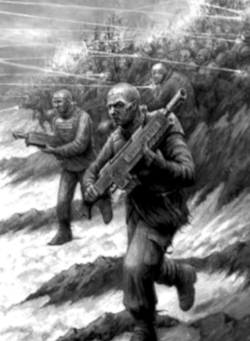
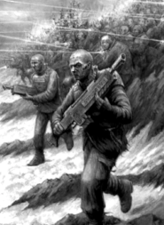
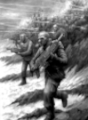

# Penal Legion

**Steam Workshop ID:** 2525618649

**Source:** [Live Steam Workshop item](https://steamcommunity.com/sharedfiles/filedetails/?id=2525618649)

**Metadata retrieved (UTC):** 2026-11-13T23:02:05+00:00

**Content:** Recovered Steam Workshop install, not reconstructed source.

## Recovered preview files







[Current Steam thumbnail](https://images.steamusercontent.com/ugc/1688269127766375223/0983EC55F2C45FD12D5500BE3E1320CACD04879E/)


## Steam Workshop description

Captured unchanged from Steam's GetPublishedFileDetails API. BBCode is retained literally rather than guessed or paraphrased.

```text
 Summary of actions and force to deploy prepared by aide Bilkerner Smither" to Battlemarshal of the Galidus Recovery task force.
	 The Imperial Gaurd has many legions serving on many worlds. These Criminal Units draw their supply from the worst of the worst, second-hand supply, Soured power packs. Spoiled ration bars, sub-Par focusing lenses, and every conceivable supply problem is experienced by the " Last Chance Brigades " for none Knowingly provide top-of-the-line gears to traitors and criminals.
	
[quote=General  Hastor Fundergrune" of the 14th penal legion.]
" Imperial Guard Penal Legions, are formed by those individuals who have committed capital crimes against the Imperium of Man but have been given a chance to redeem themselves by the Adeptus Arbites with their inevitable deaths in battle as warriors of the Imperial Guard. they  are often led By men like myself whom the Great minds of the Astra Militarum have seen just to test those who have lead Failed campaigns Like  the "Zarvo's system", or in your case made disasters of simple actions come with me and we shall together attempt to regain our honor as Imperial men "[/quote]

	The Troopers of Imperial Guard Penal Legions are Notorious for Difficult to enforce morale standards, and Criminal units have Great difficulty Holding ground as troopers Break easily and seek to Flee the battlefield. It is notoriously difficult to get those who fight reluctantly to stand their ground. However, the Deployment of cadres of Commissariat Cadets should aid in maintaining order on the battlefield. The Schola Progium of Artiex 4 has Deployed with us a number of Commissariat Cadet units for viability in battle. 

	The Commissars and the Increased Deployment of armored units should tip the scales in our favor. 
Along with the General's known Preference for imperial Naval support options, we should see the back end of this war with as few casualties as possible. The General wishes to see the regiment returned to Honor and his own name cleared to return to Full-service honors. The General also has an over-reliance on sending Lone Sargents out to secure Flanks or rush retreating enemy positions. 
	Many a man has been "Promoted" handed a Chainsword and las pistol and told to "perform a task to his death.", which is very often the case.

The armored assets (Notably the Chimera's) are to be Prioritized in our deployment schema's as the highly Fluid Conditions here continue to evolve at an accelerated pace. The dammed chaos inference from the orbital warps storms have played havoc with our com's and HQ Continues to receive reports of renegade units. Crush any who rebel, Secure and Contain territory in the name of the emperor commander.
 Fulfill your order to secure the surface at all costs.


[quote=Carved into the Wall of Pain at The Schola Progenium  ]"Give not the traitor a moments thought more then but how to destroy them."[/quote]

In the grim darkness of the far future, where the galaxy is engulfed in perpetual war, the Imperium of Man relies on the formidable logistical prowess of the Adeptus Logistica to sustain its vast war machine. The Adeptus Logistica stands as the bureaucratic engine behind the scenes, orchestrating the colossal production efforts required to maintain the Imperium's armies, fleets, and war engines in the ravaged universe.

At the heart of the Adeptus Logistica's operations are the immense Vat Farms, sprawling facilities dedicated to the accelerated growth of bulk food resources be they plant matter or synth meat alike. These farms utilize advanced biotechnology and genetic engineering to cultivate sustenance on a scale unimaginable to the citizens of the Imperium. Massive vats teem with bioengineered organisms, producing nutrient-rich substances to feed the countless billions that make up the Imperium's population. The Vat Farms are a testament to the Adeptus Logistica's ability to harness science and technology to meet the insatiable appetite of war.

[quote=Lord Fabricator Numinous, Master of the Adeptus Logistica  ]"In the vast tapestry of war, the Adeptus Logistica stands as the silent architect, weaving the threads of industry and innovation into a cloak of resilience. Our efficiency is the heartbeat of the Imperium, where each logistical endeavor is a symphony, orchestrating the survival of billions in the face of galactic adversity. In the grim darkness of the far future, the Adeptus Logistica is the unyielding forge, shaping destiny with the relentless rhythm of production. if you ate today, thank a memeber of the Logistica "[/quote]

Complementing the Vat Farms are the Extraction Pits, colossal operations designed for the large-scale extraction of raw materials essential for the Imperium's war effort. Huge devices the size of hab block with which to prize open the earth, or Sprawling teams of slave and servitor larbors to peel open the earth like a sour bandage These pits delve deep into the bowels of planets, tirelessly extracting minerals, metals, and other resources required for the production of weaponry, armor, and vehicles. The Adeptus Logistica ensures that these Extraction Pits operate with ruthless efficiency, exploiting entire planetary ecosystems to feed the relentless demand of the Imperium's war machine.

Dedicated Manufactorums stand as the final piece of the Adeptus Logistica's triumvirate of production. Each Manufactorum is specialized in the assembly and construction of specific types of war machinery, from land vehicles to weapons of mass destruction. These facilities are vast, cathedral-like structures echoing with the constant hum of machinery and the clatter of assembly lines. The Adeptus Logistica has perfected the art of parallelization, enabling these Manufactorums to produce colossal quantities of war materiel in a fraction of the time it would take lesser organizations.

The Adeptus Logistica's efficiency in managing these gargantuan facilities is a testament to the Imperium's determination to out-produce its enemies in the galaxy. In the face of constant threats and the unrelenting tides of war, the Adeptus Logistica stands unwavering, ensuring that the Imperium's war machine never falters, no matter the scale of the conflict. The dark corridors of their administrative centers echo with the clatter of keystrokes and the drone of machinery, all in service to the survival of the Imperium in the grim and unforgiving universe .

In the sprawling expanse of the Imperium's industrial might, the Adeptus Logistica's colossal facilities, though immense, often find themselves dwarfed by the awe-inspiring Titanicus factories and the planet-spanning forge world production lines. While the Logistica's Vat Farms, Extraction Pits, and Manufactorums pulsate with activity, their scale is but a fraction of the monumental Titanicus factories that birth the god-like war engines known as Titans. In the shadows of forge worlds, where molten metal flows like rivers and the thunderous clanks of colossal machinery drown out all else, the Adeptus Logistica's efforts become a vital tributary to the torrential flow of war material that sustains the Imperium's unending conflict. Despite their relative size, the Logistica Facilities stand as crucial nodes in the vast network of production that ensures the Imperium's survival

Solar Auxilia Conscripts constitute the majority of Imperial forces, originating from nearby solar systems. These rapidly enlisted infantry members are equipped with rudimentary lasguns and utilitarian armor. Their effectiveness is derived from sheer numerical superiority.
(Battlefields) Now Decay on a timer as requested.

```

Also saved as [raw Steam description](WORKSHOP_DESCRIPTION.txt).
