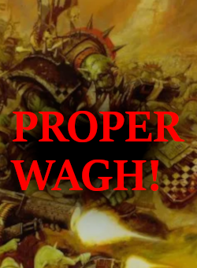
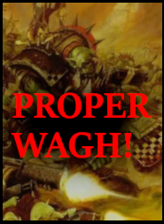

# Workshop 3038342810

**Candidate public title: Proper wagh!**

**Steam Workshop ID:** 3038342810  
**Workshop page:** [View current Steam item](https://steamcommunity.com/sharedfiles/filedetails/?id=3038342810)  
**Status:** Direct item-page title and full description not yet verified. The Steam Workshop game index and a public collection list this title under Mrcalzon02; the imported content is Orks.

## Recovered previews

These images are already present in this exact Workshop directory. They are from the backed-up Steam install; they are **not** yet confirmed to be the current online Workshop gallery.

## Description status

The exact currently published Steam description could not be retrieved from the rate-limited item page in this session. The following is **not** represented as the official description:

> Ork buildings, units, unit effects, textures, icons and faction localization. This is a summary of the recovered files, not the live Steam description.

The live title, description, Steam preview URL, author ID and update date can be retrieved together using the repository's [Steam metadata sync utility](../tools/sync_workshop_metadata.py). It uses the official keyless Steam Web API and will replace this generated document with source-verified metadata. Run from a network-connected clone:

    python tools/sync_workshop_metadata.py

No original Gladius files were moved or edited to create this record.
