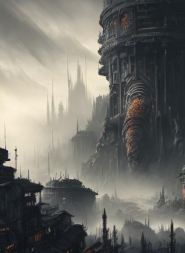

# Workshop 3107612342

**Candidate public title: Wonders and Horrors**

**Steam Workshop ID:** 3107612342  
**Workshop page:** [View current Steam item](https://steamcommunity.com/sharedfiles/filedetails/?id=3107612342)  
**Status:** Direct item-page title and full description not yet verified. The matching public mirror identifies Mrcalzon02 as author, describes new terrain and wandering neutral factions, and reports 168.59 MB, matching this imported folder's bytes in decimal MB.

## Recovered previews

These images are already present in this exact Workshop directory. They are from the backed-up Steam install; they are **not** yet confirmed to be the current online Workshop gallery.

## Description status

The exact currently published Steam description could not be retrieved from the rate-limited item page in this session. The following is **not** represented as the official description:

> Adds varied terrain such as Lunar Regolith, Sulphor Wastes, Hulk Debris, Glyph Plains and HexaTile, and introduces additional neutral wandering units including Orks, Necrons, Aeldari and Drukhari. Source: external Workshop-description mirror; this is a summary, not verbatim current Steam text.

Corroborating description mirror: https://catalogue.smods.ru/archives/531411

The live title, description, Steam preview URL, author ID and update date can be retrieved together using the repository's [Steam metadata sync utility](../tools/sync_workshop_metadata.py). It uses the official keyless Steam Web API and will replace this generated document with source-verified metadata. Run from a network-connected clone:

    python tools/sync_workshop_metadata.py

No original Gladius files were moved or edited to create this record.
