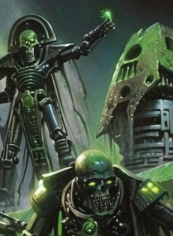
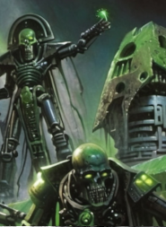
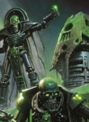

# Reclamator Awakening

**Steam Workshop ID:** 3305007655

**Source:** [Live Steam Workshop item](https://steamcommunity.com/sharedfiles/filedetails/?id=3305007655)

**Metadata retrieved (UTC):** 2026-11-13T23:02:05+00:00

**Content:** Recovered Steam Workshop install, not reconstructed source.

## Recovered preview files







[Current Steam thumbnail](https://images.steamusercontent.com/ugc/2522664248073305439/384B2E57C7ABC7403F964B761F87AECA2321A937/)


## Steam Workshop description

Captured unchanged from Steam's GetPublishedFileDetails API. BBCode is retained literally rather than guessed or paraphrased.

```text
The hum of ancient machinery filled the air as Saffrith, the Cryptark, approached his new lord, Kertacon. Saffrith’s hunched form, with its deformities in the living metal, exuded an aura of weakness and servility. His photoreceptors dimly flickered with apprehension as he prepared to deliver his report.

Saffrith began, his voice a quivering mechanical whine, “M-my Lord Kertacon, I bring news regarding the activation of our legions.” He glanced nervously at Kertacon, whose imposing figure radiated a stern authority. “I have devised a stratagem utilizing my technological prowess, which will undoubtedly serve our dynasty well In substituting for the lack of standard resurrection protocol, Due to the loss of the Tesseract Sanctum”

Kertacon’s gaze bore into Saffrith, urging him to continue. The Cryptark's craven nature was all too apparent in the subservient bow of his head and the obsequious tone he adopted.

“Our reclamation complexes will use instead the Necropolis Command Center Direct command o-override, m-my Lord, our facilities will arise at a slower pace than we might desire using my improvised R-Reclamator code —twice as slow as the standard, in fact,” Saffrith admitted, his voice faltering slightly. “This will render us vulnerable, as the facilities will take longer to reach full operational capacity. The defenses will be delayed, and our enemies may perceive us as weakened during this period. This process taking far longer to do remotely from the necropolis command center where I would be forced to reside during the entirety of the process..."

A low growl from Kertacon made Saffrith recoil, but he pressed on, knowing that he had to justify his seemingly cowardly proposal. Which just so coincidentally meant he didn't have to go to the surface... “B-but, my Lord, there is a crucial advantage to this delay. Once the complexes are fully established, the process of raising our legions will be expedited significantly—twice as fast as before. Our forces will surge forth with a rapidity that will catch our enemies unprepared. Many of your legions will awaken in a matter of days instead of years!”

Kertacon’s eyes narrowed, considering the implications. Saffrith hurried to explain further, hoping to placate his master. “However, there is a secondary consequence, my Lord. The accelerated awakening of our troops will mean that their loyalty circuits will have had less time to fully integrate. They will awaken, yes, but their allegiance to you, their new master, may not be as firmly ingrained as it would be with a more gradual reawakening.”

The Cryptark paused, allowing his words to sink in. “In essence, my Lord Kertacon, the initial vulnerability will be a strategic trade-off. By sacrificing time now, we will gain a formidable advantage later, striking swiftly and overwhelming our foes with our numbers. Yet, we must be cautious, for these hastily awakened warriors may require additional oversight to ensure their loyalty.”

Saffrith bowed deeply, his servile posture a testament to his ingrained cowardice. “I live only to serve, my Lord, and to see our dynasty restored to its rightful glory. With your wisdom guiding us, I am confident that we will triumph.”

The Cryptark awaited Kertacon’s response, hoping that his proposals, despite its inherent risks, would be seen as a testament to his cunning and value, rather than his evident cowardice. He knew he would never escape the shame of having been loyal to the previous Lord that Kertacon had replaced, he desperately hoped that he could deflect the new Lords suspicion of him by being unwaveringly loyal... even now thousands of years later, and after the great slumber the game of the nobles still continued...

TLDR: Necron faction Rebalance minor unit tweaks, building construction times changed and loyal reductions. mostly Changes to Building construction times
```

Also saved as [raw Steam description](WORKSHOP_DESCRIPTION.txt).
