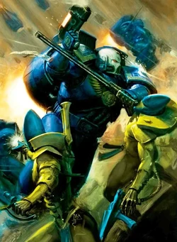
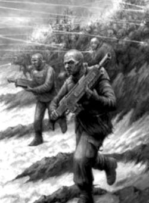
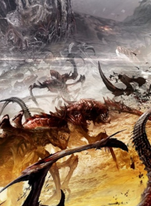
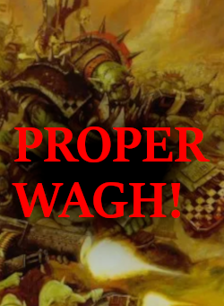
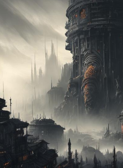
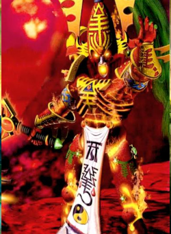
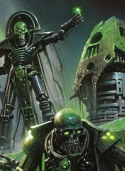

# Workshop catalog — verified titles, descriptions and previews

All seven recovered Gladius Workshop mods have been matched against Steam's **official GetPublishedFileDetails API**, including each ID's current published title, full description, source URL and thumbnail URL. The game app ID checked by the importer is **489630**, and all seven returned successful records.

**Last metadata retrieval (UTC):** 2026-11-13T23:02:05+00:00  
**Verified source backup:** The numeric Workshop folders on `main`; no original mod contents were renamed or edited.

| Local recovered preview | Official Steam title | Workshop folder | Published description | Content areas |
|---|---|---|---|---|
|  | **[Veteran Marines](https://steamcommunity.com/sharedfiles/filedetails/?id=2175959340)** | [2175959340](../2175959340/WORKSHOP.md) | [Full Steam description](../2175959340/WORKSHOP_DESCRIPTION.txt) | SpaceMarines |
|  | **[Penal Legion](https://steamcommunity.com/sharedfiles/filedetails/?id=2525618649)** | [2525618649](../2525618649/WORKSHOP.md) | [Full Steam description](../2525618649/WORKSHOP_DESCRIPTION.txt) | AstraMilitarum |
|  | **[Horrors of The  Numberless Horde](https://steamcommunity.com/sharedfiles/filedetails/?id=2525618729)** | [2525618729](../2525618729/WORKSHOP.md) | [Full Steam description](../2525618729/WORKSHOP_DESCRIPTION.txt) | Tyranids |
|  | **[Proper wagh!](https://steamcommunity.com/sharedfiles/filedetails/?id=3038342810)** | [3038342810](../3038342810/WORKSHOP.md) | [Full Steam description](../3038342810/WORKSHOP_DESCRIPTION.txt) | Orks |
|  | **[Wonders and Horrors](https://steamcommunity.com/sharedfiles/filedetails/?id=3107612342)** | [3107612342](../3107612342/WORKSHOP.md) | [Full Steam description](../3107612342/WORKSHOP_DESCRIPTION.txt) | Neutral, Terrain |
|  | **[Aeldari Ascendant](https://steamcommunity.com/sharedfiles/filedetails/?id=3267312159)** | [3267312159](../3267312159/WORKSHOP.md) | [Full Steam description](../3267312159/WORKSHOP_DESCRIPTION.txt) | Eldar |
|  | **[Reclamator Awakening](https://steamcommunity.com/sharedfiles/filedetails/?id=3305007655)** | [3305007655](../3305007655/WORKSHOP.md) | [Full Steam description](../3305007655/WORKSHOP_DESCRIPTION.txt) | Necrons |

Each Workshop folder contains:

- `SteamID.txt`: exact Workshop ID matching the folder name.
- `Preview.png`, `Preview1.png`, `Preview2.png`: three recovered local preview images from the installed Workshop files.
- `WORKSHOP.md`: the official title, live Steam item link and thumbnail URL, all three local preview images, and the description captured from Steam.
- `WORKSHOP_DESCRIPTION.txt`: full published Steam description as returned by the API, including original Steam BBCode.

The images recovered from the Steam installation are preserved as such; the API confirms the live primary thumbnail URL, **not** whether all three older local preview images still match the full online gallery. Descriptions are snapshots from the retrieval time rather than guaranteed future-live copies.

## Refresh the Steam metadata

From an internet-connected clone, after pulling `main`:

```powershell
py -3 tools\sync_workshop_metadata.py --check-only
py -3 tools\sync_workshop_metadata.py --dry-run
py -3 tools\sync_workshop_metadata.py
```

The script queries Steam without a key, verifies each item ID, refuses incomplete API responses by default, and writes only documentation and catalog files. Review diffs in GitKraken before pushing. **It does not publish or update any Steam Workshop item.**

The game mod files remain a recovered published baseline. Full in-game runtime compatibility, dependencies, and byte-for-byte comparison against Steam's local cache still require separate checks.
