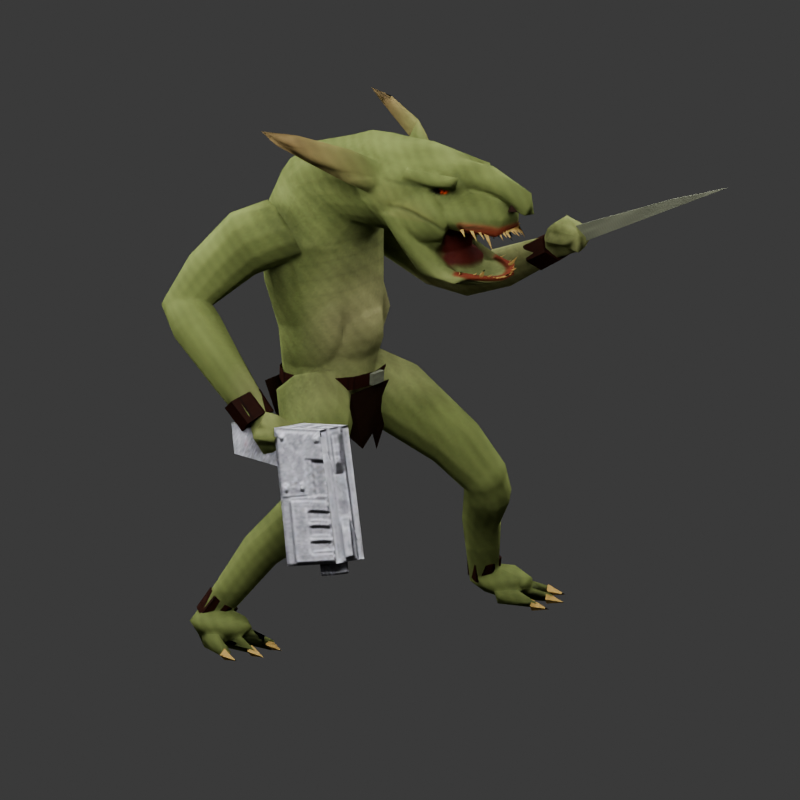
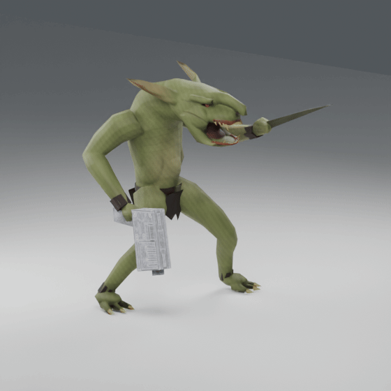

# Grot replacement

The accepted Grot replaces the old half-scale Ork model in Proper wagh!
`3038342810/Data`. Existing `Orks/Grotz`, `Orks/GrotzKamando`, `Neutral/Grotz`
and `Neutral/GrotzKamando` definitions use the replacement. No unit is added.
Costs, stats, traits, group sizes, recruitment and construction/AI effects are
preserved; only model assembly and visual animation/timing references change.

The 1,540-triangle character has a fitted 19-bone skeleton, textured eyes,
36 outward snags and a closed continuous mouth/throat/body. Native body, pistol
and shank MSH files share a 1024-square Diffuse/Normal/SIC atlas. The pistol has
a `.Muzzle` socket. Existing group sizes remain six regular Grotz and three Sneaks.

Idle, movement, firing, melee, death and construction references use fitted ANM
clips at 24 fps. Charge/defense use melee; nine-frame MoveBegin/MoveEnd assets are
included. The optional grenade action retains gameplay with a fitted raise-and-
release visual fallback. Snarl, run and hit reaction are also included as assets.
The old Ork clips are not used with the new fitted skeleton.

Actual MSH/ANM/DDS files were independently reimported across 35 poses. Maximum
body/weapon world-vertex difference was below 0.00001 units. The animated GLB was
also reimported and checked. Native asset checks pass; actual Gladius combat
and gameplay timing have not been verified. Nothing is published to Steam by
this repository integration.

[Editable model and animations](../model-workbench/Grot-Sneak/README.md).
[Native verification](grot/native-verification.json).
[Animation verification](grot/animation-verification.json).

Validate the repository package without Blender or third-party modules:
`python tools/validate_grot_repository.py`.
The runtime/source hashes and preserved gameplay signatures are recorded in
`docs/grot/manifest.json`. Blender export/verification helpers are in `tools`;
they require an installed Gladius copy and the local community importer used
for the existing project workflow. Installed local AI-pilot overrides remain
separate and should retain their own gameplay while pointing to these assets.
