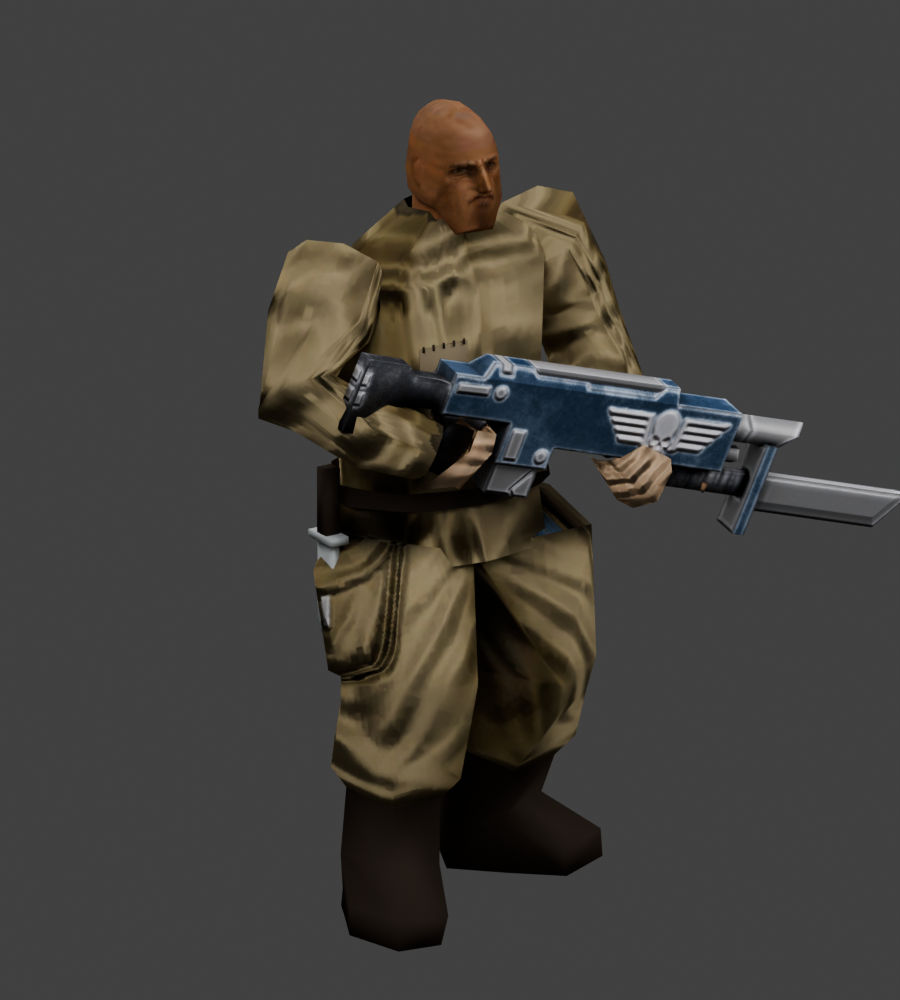
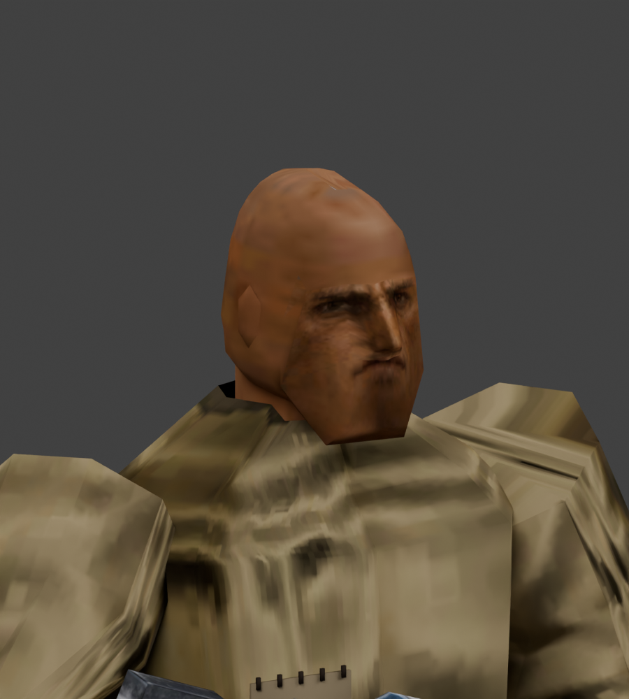

# Penal Legion standard trooper runtime integration

The approved standard trooper is the actual `AstraMilitarum/Guardsman` in the
existing Penal Legion mod (`2525618649`). Its unit XML now points to
`Units/Foundry/PenalStandardTrooper` for mesh and material. No separate mod is
created. The previous source-only delivery had left this unit using the old
Guardsman runtime mesh and material.

The approved `Standard-Trooper.blend` remains byte-identical (SHA-256
`4fafa0935604df16a33b5da34eb9ae7ac0e18a79005bf683a6e5362ec26e527c`).
Its bald head, user-edited topology, ragged tunic/sleeves, native cloth UVs,
boots, belt, stitched patches and hip knife are exported on the original
28-bone Guardsman skeleton. The native lasgun and its muzzle/attachment are
retained. The old chainsword-as-bayonet visual is removed; the Bayonet gameplay
rule, research gates, stats, costs, group size and all other gameplay remain.

The runtime body contains 1,090 triangles, plus the unchanged 196-triangle
lasgun. Seven zero-area triangles introduced by triangulating source ngons
were omitted; source geometry was not edited and the visible surface is
unchanged. The 512-square approved diffuse tile is preserved inside the runtime
atlas alongside material swatches for leather, steel and patches. Three legacy
DXT5 DDS files contain diffuse, normal and SIC channels, with padded neutral
head masks to prevent inherited team-color/normal leakage.

All eleven original native Guardsman clips are retained. Independent reimport
of the actual mesh/material/DDS/XML checked 33 poses; maximum world-vertex
difference was below 0.00003 model units after the existing 0.8 unit scale.
[Native verification](standard-trooper/native-verification.json),
[runtime hashes](standard-trooper/runtime-manifest.json) and
[visual review](standard-trooper/visual-review.json) bind this result to the source.
In-game combat and save/load validation remain unverified.

Validate the actual runtime package with `python tools/validate_standard_trooper.py`.
Deploy through `tools/deploy_integrated_mods.py` while Gladius is closed.
The model is part of the original Penal Legion package both locally and in
the GitHub repository; Steam Workshop publication is a separate step.
