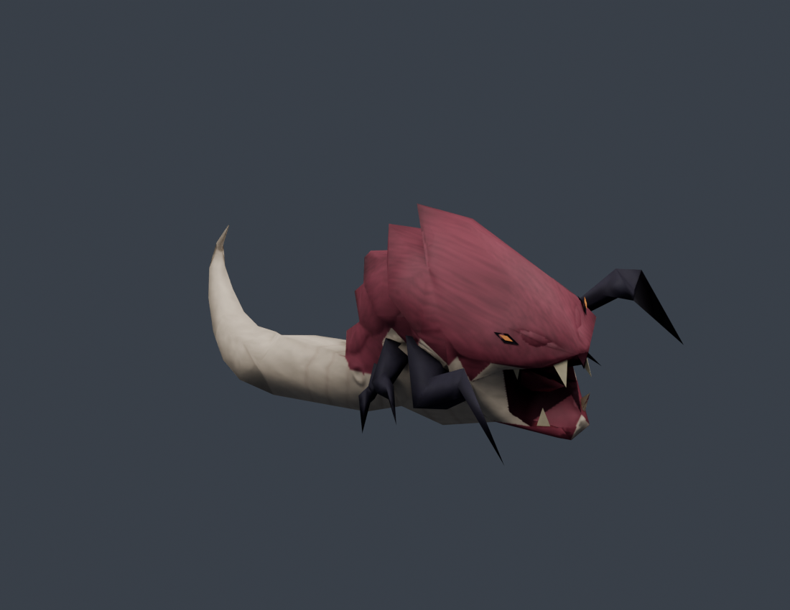
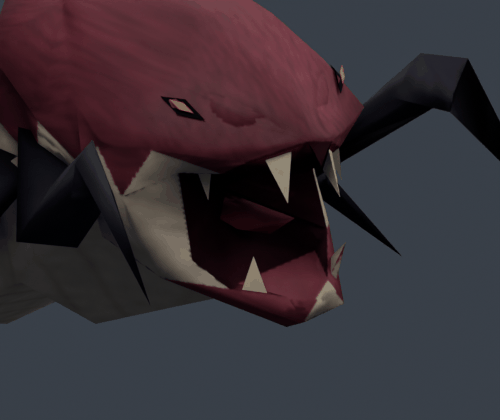

# Ripper replacement

The accepted revision 4 replaces the scaled Hormagaunt appearance of Ripperswarm
in `2525618729/Data`. Existing stats, costs, traits, weapons, sounds, action
timings and the ten-member swarm formation are preserved.

The single creature is 450 triangles with a 34-bone rig, six connected teeth,
six legs and a whip tail. Native Idle (49), Move (25), Melee (25), Die (37),
MoveBegin (9) and MoveEnd (9) clips run at 24 fps. Locomotion is in place.
Diffuse, normal and SIC DDS maps are 512 square. The editable Blender source
packs all four source texture maps; GLB carries four clips and baked PBR maps.

Native MSH/ANM/DDS reimport passed, including 16 sampled poses, zero measured
tooth-root seam gap and source/native geometry agreement within 0.000004 units.
The repository validator checks file hashes, native formats, skin weights,
animation references and preservation of gameplay XML. Live game validation
remains pending; the asset is installed locally but has not been observed in
game. No Steam Workshop upload was performed.

Run `python tools/validate_ripper_repository.py` for the standalone checks.
To rebuild runtime files, open the published Blender source and run
`tools/export_ripper_native.py` with Blender's Python, then `tools/package_ripper.py`
with Pillow available. Export uses the existing shared Sergeant writer and
an installed Gladius Guardsman mesh for its native header. Optional full
retopology regeneration (`build_ripper_lowpoly.py`) requires the separately
supplied donor; the accepted packed source does not require that original file.
Native visual verification uses the community Gladius importer configured by
`verify_ripper_native.py`. Environment variables RIPPER_STAGE_DIR and
RIPPER_NATIVE_DIR may select alternate staging and package directories.

## Provenance

Adapted from the user-supplied *Chompy Xeno Bugs* sculpt by minipainting40k:
https://cults3d.com/en/3d-model/game/chompy-xeno-bugs . The listing displays
CULTS PU and No AI notices. Those source terms remain applicable; inclusion
here does not assert a new blanket license or third-party license clearance.
This derivative adds low-poly retopology, tail and connected teeth, new texture
atlases, a unified rig and new animation clips. Original donor downloads,
reference photographs, backups and unrelated local work are excluded.

