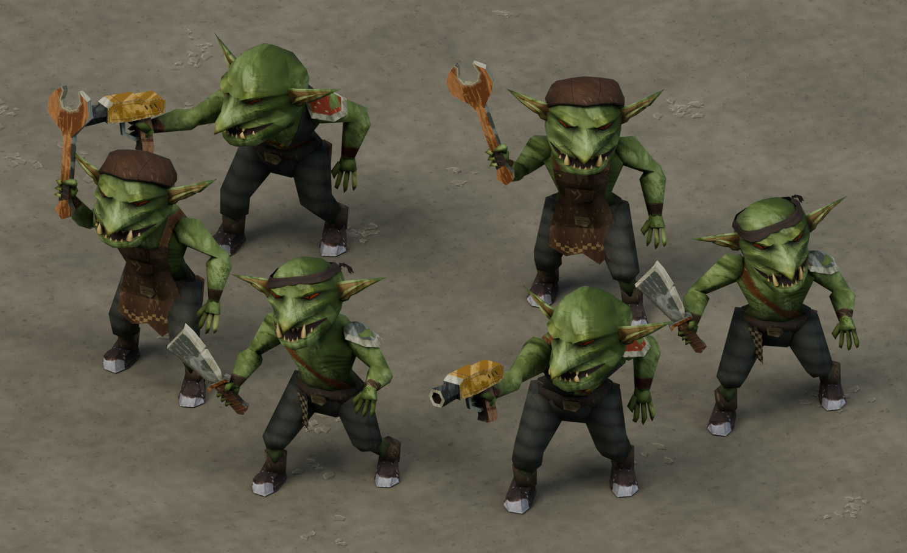

# Animated Grot mob

Open **Grot-Mob-Animated.blend** and press **Space**. The scene opens on the first frame of the advance. The six Grots belong to one formation, with two spanner carriers, two slugga gunners, and two choppa carriers. Select the **Grot Mob** root in the Outliner to work with the formation. Each member also has its own armature and collection.

The three timeline markers switch the whole group together. Each take plays at 24 fps.

| Take | Blender frames | Movement |
| --- | ---: | --- |
| Mob Idle | 1–97 | The Grots glance about, breathe, and shift their free arms, each on separate timing. |
| Mob Scrap | 98–194 | The two gunners fire at different moments while the other four swing spanners or feint with their choppas. |
| Mob Advance | 195–315 | The group travels 55.2 Blender units forward over five seconds. Each Grot uses its own footfall phase on a 24- or 30-frame gait. |

**Grot-Mob-Animated.glb** contains the complete unit and the three selectable clips. Both the Blender scene and the GLB embed the three approved character atlases. The characters total 8,972 triangles across six 17-bone rigs. The editable Blender file includes a separate review stage. The portable file contains the formation alone.

[Watch the mob](Grot-Mob-Playback.mp4) · [Animation verification](verification.json)

This is the grouped workbench asset. Native Gladius conversion and in-game playback have not been tested for this formation.
