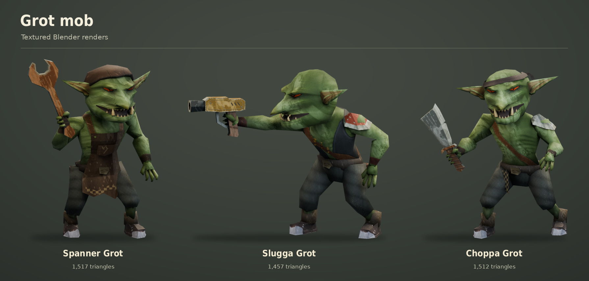

# Grot mob

Open **Grot-Mob.blend** to edit the three painted, rigged figures together. Each character also has a standalone GLB with its own skeleton, actions, and embedded diffuse atlas. The individual files open with the origin between the boots.

| Figure | GLB | Triangles, including equipment | Actions |
| --- | --- | ---: | --- |
| Spanner Grot | [Grot-Mek.glb](Grot-Mek.glb) | 1,517 | Idle, Spanner strike |
| Slugga Grot | [Grot-Gunner.glb](Grot-Gunner.glb) | 1,457 | Idle, Pistol recoil |
| Choppa Grot | [Grot-Cutter.glb](Grot-Cutter.glb) | 1,512 | Idle, Blade feint |

The supplied Ork Boy and the Foundry's Squig Hunter guided the mesh density, painted skin, workwear, and metal finish. The boot shells retain geometry and paint from the supplied Ork Boy. Each figure uses a 17-bone rig and a packed 1024 × 1024 diffuse atlas. The three loose PNGs are available for repainting.

The gunner leans over the lead foot, turns the firing shoulder forward, and extends the slugga. Three brass cartridges sit in leather keepers across the chest sling. All three figures measure 26.21 units from boot sole to bare crown in the starting pose. The supplied Ork Boy measures 58.32 units in its reference pose.

To preview an action in Blender, select the corresponding armature in the Mek, Gunner, or Cutter collection. Choose its named action in the Action Editor and play at 24 fps. The scene opens with Idle active.

[Character actions](Grot-role-actions.gif) · [Rear and elevated views](Grot-Mob-views.jpg) · [Same-scale comparison](Grot-scale-comparison.jpg)

This is an appearance and animation review set. The Blender scene and all three GLBs were reopened and measured. [Verification results](verification.json) include scale, geometry, UVs, image embedding, skin weights, grip contact, boot motion, and return to rest. Native Gladius conversion and in-game testing are pending.
