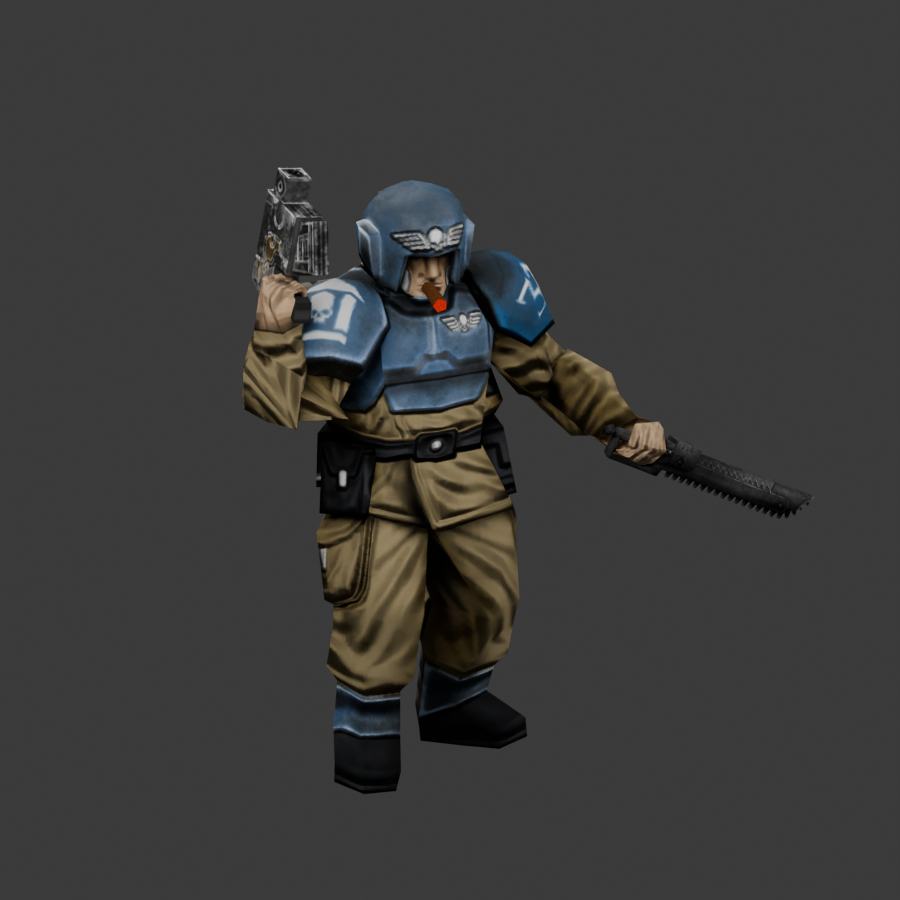
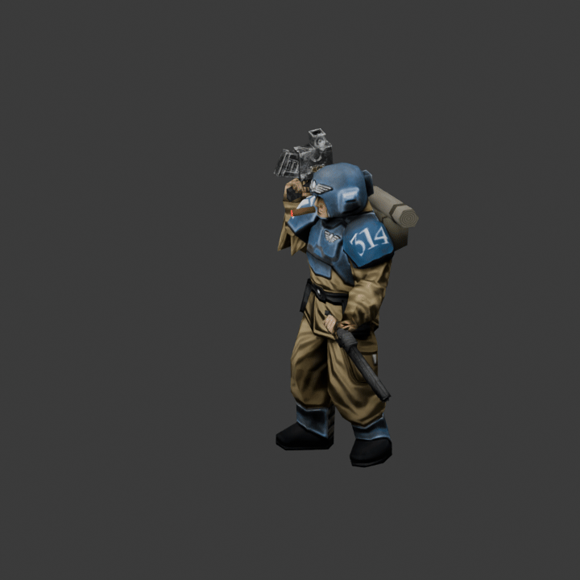

# Accepted Penal Legion veteran sergeant

Open `Sergeant-Animation-Work.blend` in Blender 5.0. Images are packed into the file.
This is the editable source of the installed native assets described in
[the sergeant notes](../../docs/SERGEANT_MODEL.md).

The original Guardsman head, hands and textures are retained, with the user-edited
backpack/bedroll and weapon placement, a curled thumb, and a brown cigar with a
red emissive tip. The accepted melee clip includes the corrected knee direction.

Actions in the Action Editor:

| Action suffix | Frames |
|---|---:|
| Idle (draft) | 1–81 |
| Walk (draft) | 1–17 |
| Pistol fire (draft) | 1–49 |
| Chainsword lunge (draft) | 1–61 |

The `(draft)` labels are retained source action names. The lunge is the accepted
melee version; the earlier stationary chop remains for comparison. The file opens
on the lunge action. Native game assets omit the importer's preview helper bones.

See `runtime-pack.png` and `cigar-closeup.png` for the equipment. These are local
source/export reviews; a live Gladius combat test remains pending.
